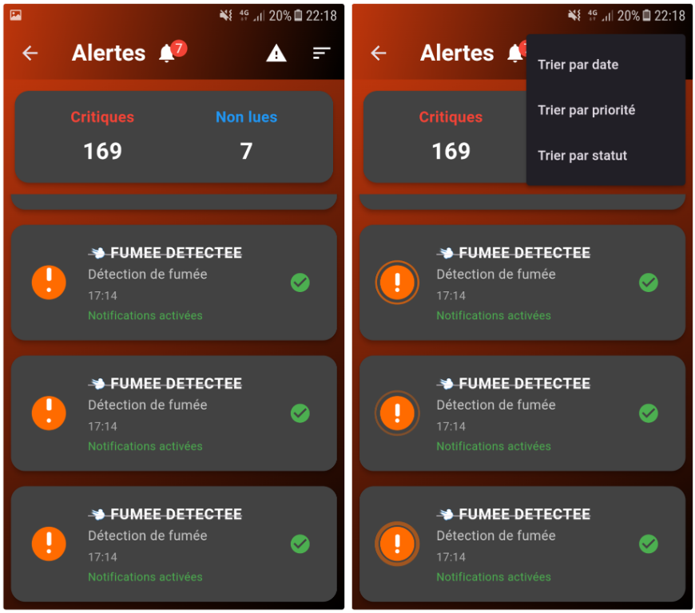
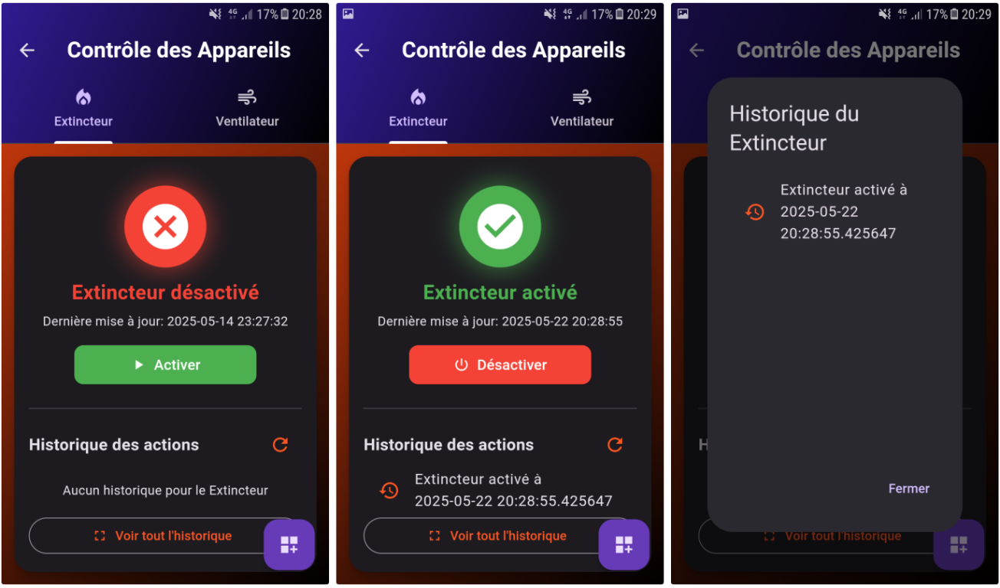
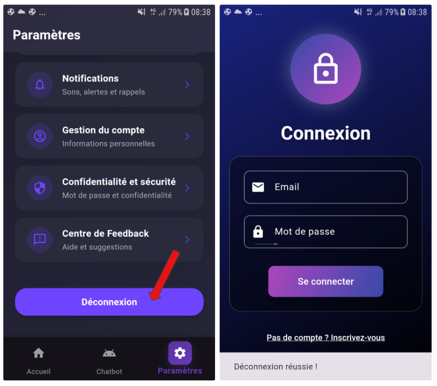
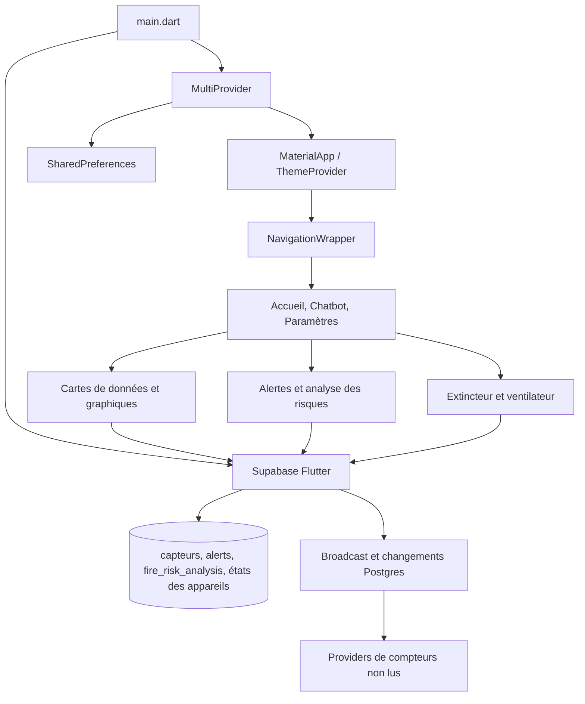

# Smart Fire Alarm — Alarme incendie intelligente

Application mobile Flutter réalisée dans le cadre d’un projet de fin d’études. Elle rassemble le suivi de capteurs, la visualisation des mesures, les alertes, l’analyse des risques et le pilotage d’équipements.

> Ce projet est un prototype académique et ne remplace pas un système d’alarme certifié ni les services de secours.

## Captures d’écran

### Tableau de bord et alertes




### Mesures et graphiques


### Analyse des risques d’incendie


### Contrôle des équipements




### Assistant de sécurité incendie


### Connexion, compte et paramètres




## Fonctionnalités

- Connexion à l’application et navigation entre l’accueil, le chatbot et les paramètres.
- Suivi des mesures de température, d’humidité, de concentration de gaz, de flamme et de fumée.
- Mise à jour des données de capteurs avec Supabase Realtime/Broadcast.
- Graphiques de température, d’humidité et de gaz avec affichage de 10, 20 ou 30 points et option temps réel.
- Alertes avec compteurs de notifications critiques et non lues, filtres et options de tri.
- Consultation des analyses de risque d’incendie avec niveau et score par capteur.
- Commandes dédiées et rapides pour l’extincteur et le ventilateur, avec affichage de leur état.
- Assistant de sécurité incendie avec saisie texte et fonctions vocales.
- Réglages du thème, du compte, des notifications, de la confidentialité et du feedback.

## Architecture

L’application est initialisée dans `lib/main.dart` : Supabase est configuré, puis `MultiProvider` fournit l’état partagé à l’interface Flutter. `NavigationWrapper` organise les onglets Accueil, Chatbot et Paramètres. Les écrans et widgets sont séparés dans `lib/views/` et `lib/widgets/`; les modèles décrivent les mesures et les alertes.



Les mesures sont lues dans `capteurs`; les alertes et les analyses de risque proviennent de `alerts` et `fire_risk_analysis`. Le pilotage utilise les tables d’état de l’extincteur et du ventilateur. Les providers gèrent notamment le thème et les compteurs ; `SharedPreferences` conserve des préférences et l’historique local du chatbot. Des services dédiés gèrent les alertes et les notifications.

## Technologies

- **Flutter / Dart** pour l’application mobile.
- **Supabase** pour l’authentification, les données et les flux temps réel.
- **Provider** pour l’état partagé.
- **fl_chart** et **Syncfusion Charts** pour les visualisations.
- **SharedPreferences** pour les préférences et l’historique local.
- **speech_to_text** et **flutter_tts** pour les fonctions vocales.
- **permission_handler**, **url_launcher** et **image_picker** pour les fonctions de l’application.

## Lancer l’application

Prérequis : Flutter avec un SDK Dart compatible avec `^3.7.0`, ainsi qu’un appareil ou un émulateur configuré.

Configurez l’URL Supabase et une clé anon dans l’initialisation de `Supabase` dans `lib/main.dart`, et définissez les règles d’accès nécessaires sur les tables et les flux Realtime. Ne publiez jamais de clé `service_role` dans une application mobile.

```bash
flutter pub get
flutter run
```

Pour générer un APK Android :

```bash
flutter build apk
```
