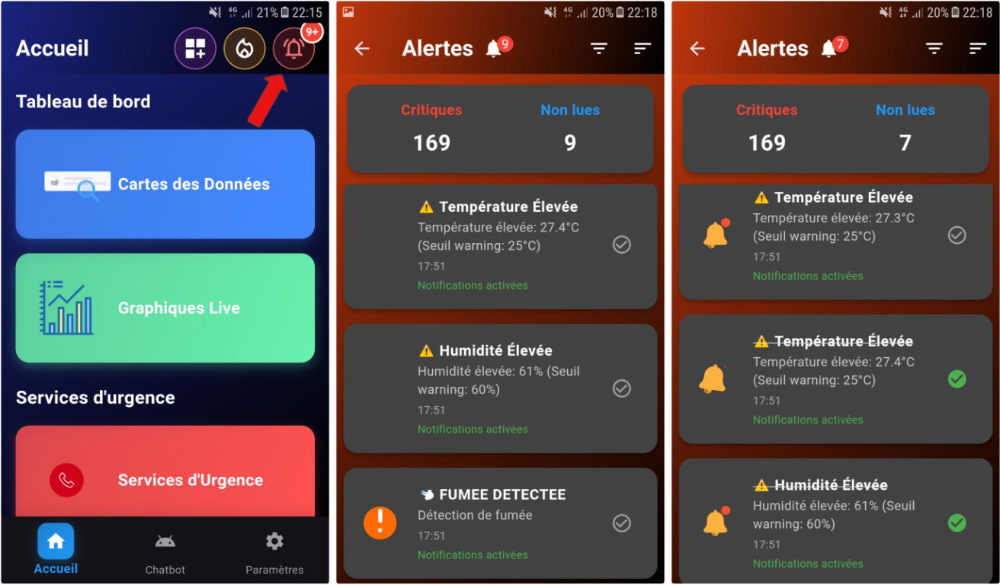
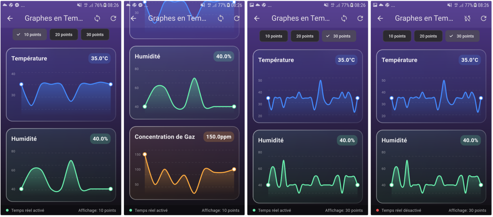
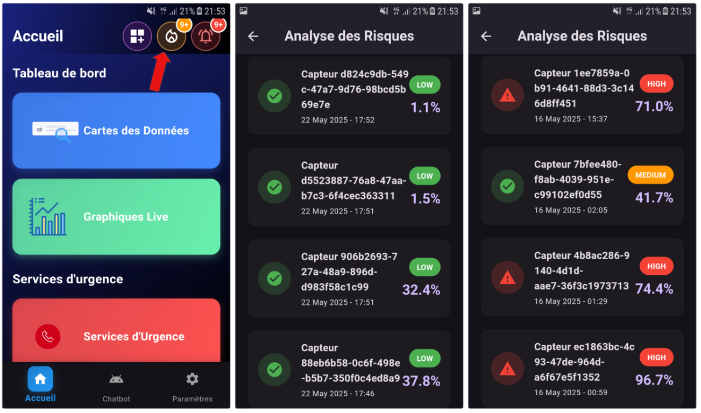
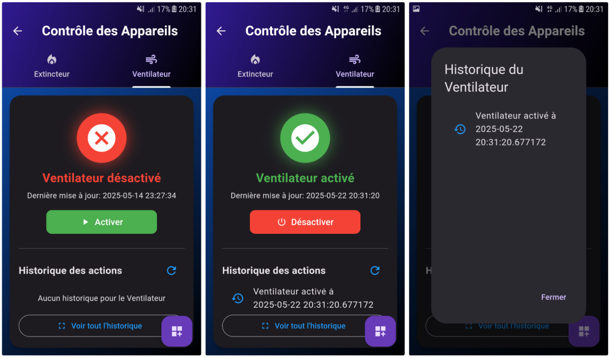
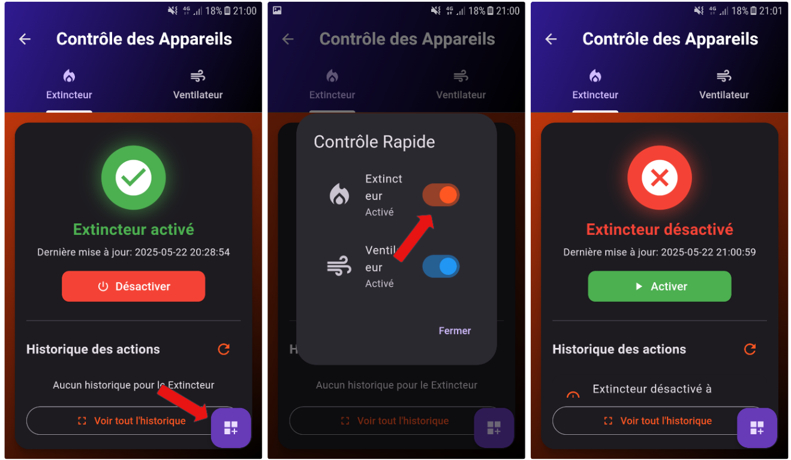
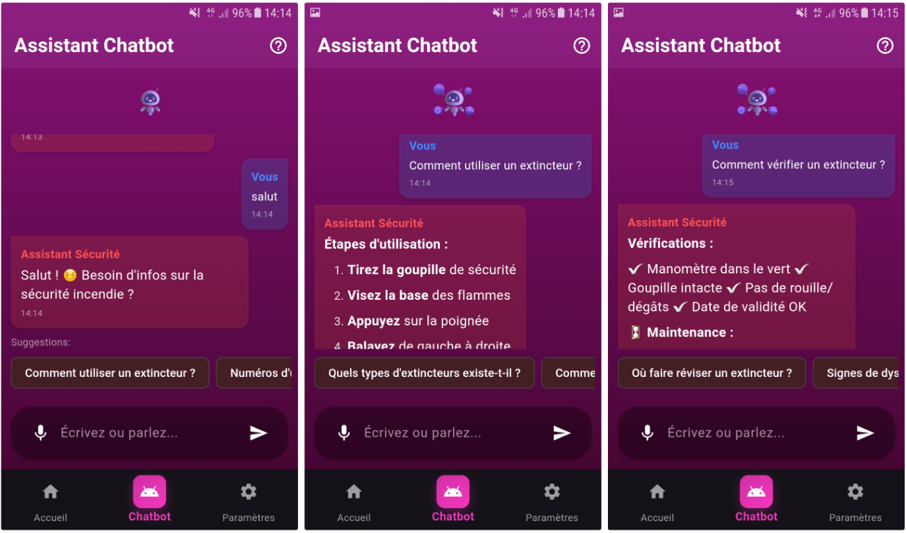
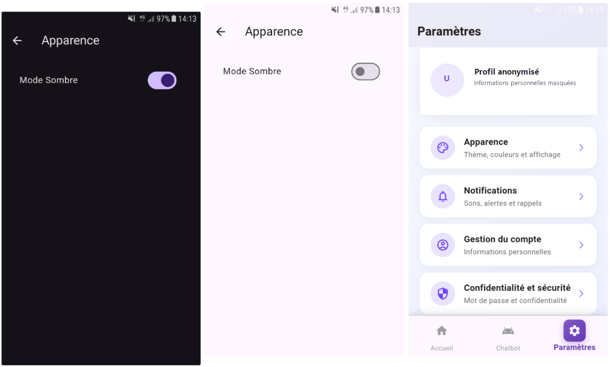
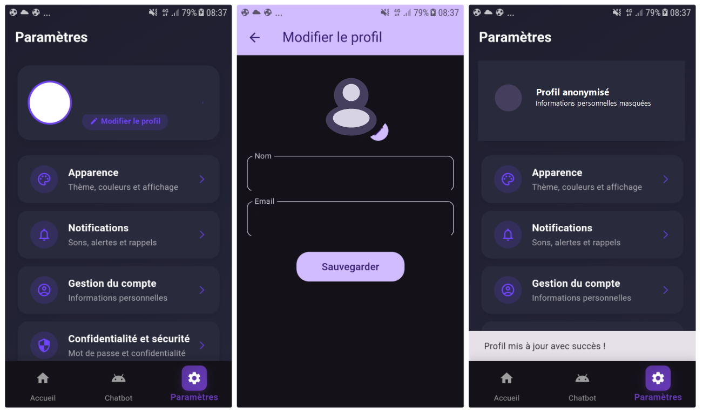
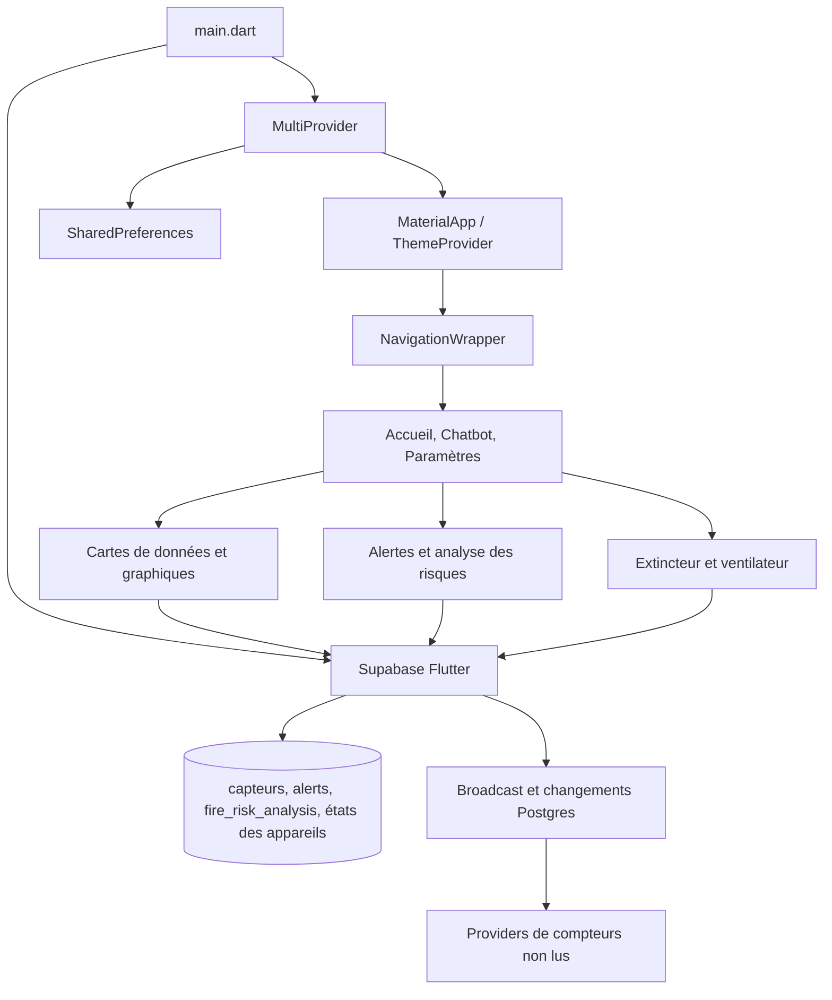

# Smart Fire Alarm — Alarme incendie intelligente

Application mobile Flutter réalisée dans le cadre d’un projet de fin d’études. Elle rassemble le suivi de capteurs, la visualisation des mesures, les alertes, l’analyse des risques et le pilotage d’équipements.

> Ce projet est un prototype académique et ne remplace pas un système d’alarme certifié ni les services de secours.

## Fonctionnalités par module

### 1. Tableau de bord et suivi des capteurs

L’accueil donne une vue rapide sur les mesures et l’état des capteurs. Les graphiques permettent de consulter les relevés de température, d’humidité et de gaz, de choisir le nombre de points affichés et d’activer ou désactiver le mode temps réel.

<table>
  <tr>
    <td align="center" width="50%"><strong>Vue d’ensemble</strong><br></td>
    <td align="center" width="50%"><strong>Mesures et graphiques</strong><br></td>
  </tr>
</table>

### 2. Alertes et analyse des risques

Les alertes peuvent être consultées et triées depuis l’application, avec des indicateurs de notifications non lues. L’écran d’analyse présente le niveau et le score de risque associés aux capteurs.

<table>
  <tr>
    <td align="center" width="50%"><strong>Gestion des alertes</strong><br></td>
    <td align="center" width="50%"><strong>Évaluation du risque</strong><br></td>
  </tr>
</table>

### 3. Pilotage des équipements

Des écrans dédiés affichent l’état de l’extincteur et du ventilateur. Des commandes rapides regroupent les actions principales. Les états des appareils sont synchronisés avec les données Supabase du projet.

<table>
  <tr>
    <td align="center" width="50%"><strong>Extincteur</strong><br></td>
    <td align="center" width="50%"><strong>Ventilation</strong><br></td>
  </tr>
  <tr>
    <td colspan="2" align="center"><strong>Accès rapide aux commandes</strong><br></td>
  </tr>
</table>

### 4. Assistant de sécurité incendie

Le chatbot propose une interface de questions-réponses avec des suggestions et des fonctions vocales. Les captures montrent l’écran d’accueil de l’assistant et des exemples d’échanges.

<table>
  <tr>
    <td align="center" width="50%"><strong>Accueil de l’assistant</strong><br></td>
    <td align="center" width="50%"><strong>Exemples de conversation</strong><br></td>
  </tr>
</table>

### 5. Connexion, compte et personnalisation

Les paramètres regroupent les préférences d’affichage, la gestion du profil et les options du compte. L’application propose également un écran de connexion.

Les captures d’écran du profil ont été anonymisées pour protéger les informations personnelles.

<table>
  <tr>
    <td align="center" width="50%"><strong>Connexion et paramètres</strong><br></td>
    <td align="center" width="50%"><strong>Thème et profil</strong><br></td>
  </tr>
  <tr>
    <td colspan="2" align="center"><strong>Informations du compte</strong><br></td>
  </tr>
</table>

## Architecture

L’application est initialisée dans `lib/main.dart` : Supabase est configuré, puis `MultiProvider` fournit l’état partagé à l’interface Flutter. `NavigationWrapper` organise les onglets Accueil, Chatbot et Paramètres. Les écrans et widgets sont séparés dans `lib/views/` et `lib/widgets/`; les modèles décrivent les mesures et les alertes.



Les mesures sont lues dans `capteurs`; les alertes et les analyses de risque proviennent de `alerts` et `fire_risk_analysis`. Le pilotage utilise les tables d’état de l’extincteur et du ventilateur. Les providers gèrent notamment le thème et les compteurs ; `SharedPreferences` conserve des préférences et l’historique local du chatbot. Des services dédiés gèrent les alertes et les notifications.

## Technologies

- **Flutter / Dart** pour l’application mobile.
- **Supabase** pour l’authentification, les données et les flux temps réel.
- **Provider** pour l’état partagé.
- **fl_chart** et **Syncfusion Charts** pour les visualisations.
- **SharedPreferences** pour les préférences et l’historique local.
- **speech_to_text** et **flutter_tts** pour les fonctions vocales.
- **permission_handler**, **url_launcher** et **image_picker** pour les fonctions de l’application.

## Lancer l’application

Prérequis : Flutter avec un SDK Dart compatible avec `^3.7.0`, ainsi qu’un appareil ou un émulateur configuré.

Configurez l’URL Supabase et une clé anon dans l’initialisation de Supabase dans `lib/main.dart`, et définissez les règles d’accès nécessaires sur les tables et les flux Realtime. Ne publiez jamais de clé `service_role` dans une application mobile.

```bash
flutter pub get
flutter run
```

Pour générer un APK Android :

```bash
flutter build apk
```
